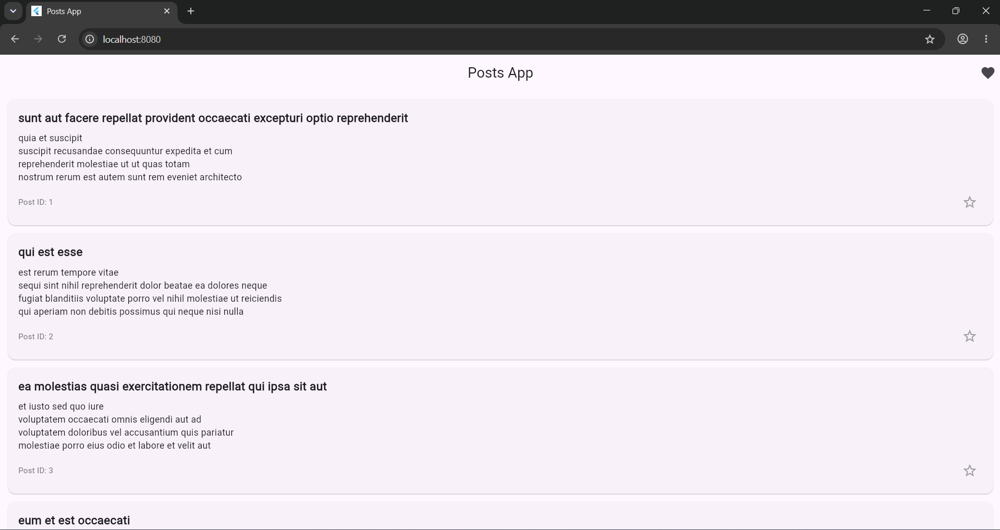
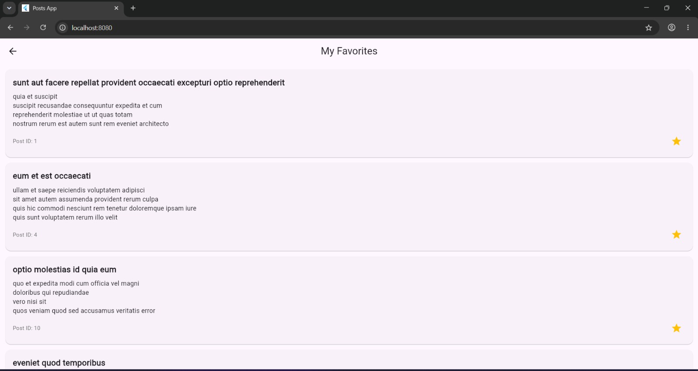
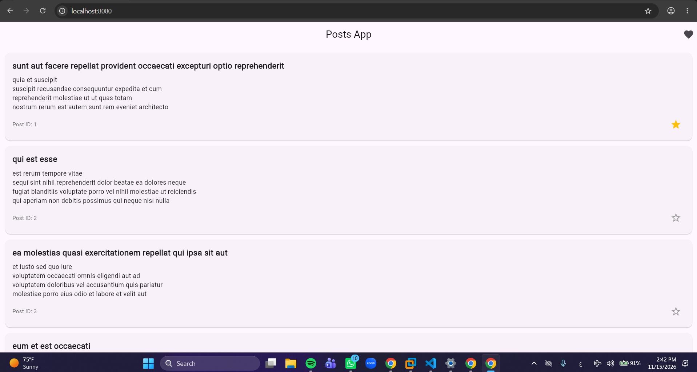

# Posts App – Flutter & Hive

A Flutter application that fetches posts from an online API and stores them locally using Hive. Users can browse posts, manage their favorite posts, and access saved data even when offline.

## Features

- Fetch posts from JSONPlaceholder API.
- Store posts locally using Hive.
- Load cached posts when there is no internet connection.
- Add and remove posts from Favorites.
- Display favorite posts on a separate screen.
- Update favorite status immediately.
- Save favorites locally so they remain available after restarting the app.
- Display an empty state when there are no favorite posts.

## Technologies Used

- **Flutter** – Application development framework.
- **Dart** – Programming language.
- **Hive** – Local NoSQL database.
- **HTTP** – API requests.
- **JSONPlaceholder** – Online posts API.

## Project Structure

```text
lib/
├── main.dart
├── models/
│   ├── post_model.dart
│   └── post_model.g.dart
├── screens/
│   ├── posts_screen.dart
│   └── favorites_screen.dart
└── services/
    ├── post_service.dart
    └── favorites_service.dart
```

## Local Storage

The application uses two Hive boxes:

- `postsBox`: Stores posts fetched from the API for offline access.
- `favoritesBox`: Stores the user's favorite posts separately.

Favorite posts are stored using their post IDs as keys.

## Getting Started

### Prerequisites

- Flutter SDK
- Dart SDK
- Visual Studio Code or another Flutter-compatible IDE

### Installation

1. Clone the repository:

```bash
git clone https://github.com/RodinaMohamed18/posts-app-hive.git```

2. Navigate to the project directory:

```bash
cd posts_app
```

3. Install dependencies:

```bash
flutter pub get
```

4. Run the application:

```bash
flutter run -d chrome --web-port 8080
```

## Testing

The application was tested for the following scenarios:

- Fetching and displaying posts.
- Adding and removing favorite posts.
- Displaying saved favorites.
- Showing the "No favorites yet" empty state.
- Preserving favorites after restarting the application.
- Loading cached posts while offline.
- Preserving favorite posts while offline.
- Running Flutter code analysis successfully.

## Screenshots

### Posts Screen


### Favorites Screen


### Offline Mode


## API

Posts are fetched from:

https://jsonplaceholder.typicode.com/posts

